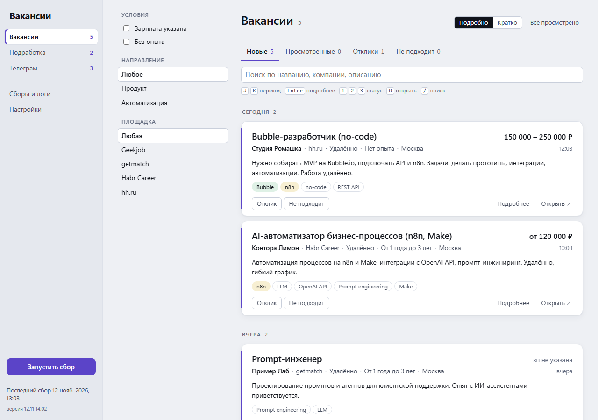
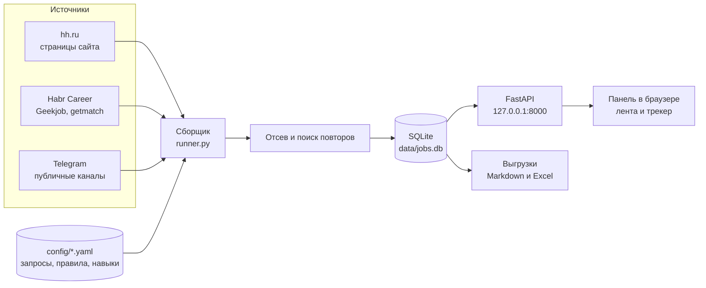
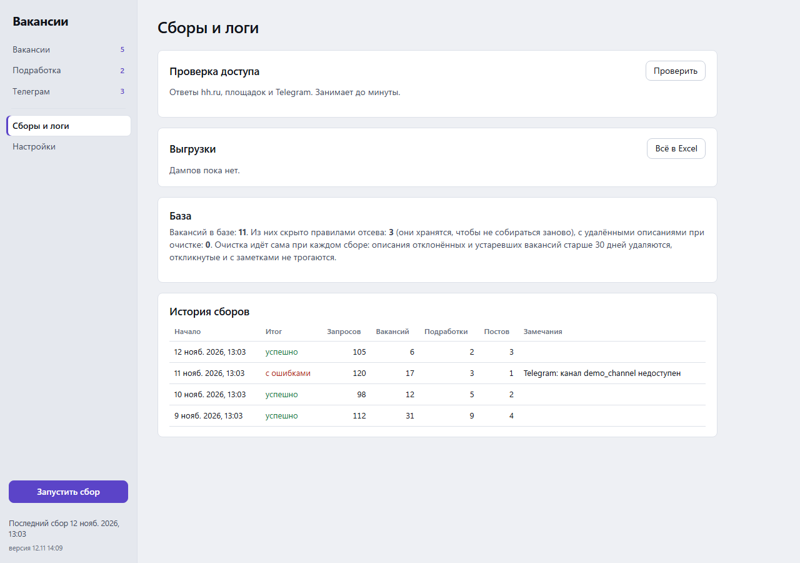

# job-collector

Локальный сборщик удалённых вакансий с нескольких площадок и панель для отбора и трекинга откликов.



*Скриншоты сняты на вымышленных данных.*

## Задача

Удалённые вакансии и подработка разбросаны по hh.ru, нишевым площадкам и Telegram-каналам. Если смотреть всё вручную, каждый день уходит много времени на одни и те же объявления, дубли и заведомо неподходящие варианты. Проект раз в день собирает всё в одну ленту, сам убирает лишнее по понятным правилам и помогает вести учёт откликов.

## Как работает

1. **Сбор.** Источники опрашиваются по очереди. hh.ru читается через страницы сайта, Habr Career, Geekjob и getmatch через их публичные страницы и ленты, Telegram через веб-превью публичных каналов `t.me/s/<канал>`. Для каждого запроса запоминается время последнего успешного сбора, поэтому следующий запуск берёт только новое.
2. **Детали.** Для новых вакансий загружается полное описание, навыки, формат работы и график.
3. **Отсев.** Правила из `exclude.yaml` скрывают вакансии по названию, требованиям и условиям (например, «менеджер» в названии или работа только в офисе). Строки «будет плюсом» требованиями не считаются. Отсеянное хранится в базе, чтобы не собираться заново.
4. **Повторы.** Одна и та же вакансия от одной компании на разных площадках помечается как повтор по похожести названия.
5. **Хранение.** Всё пишется в SQLite. Перед каждым сбором делается резервная копия базы, старые описания со временем удаляются.
6. **Панель.** Локальный сервер отдаёт ленту с группами по дням, фильтрами, подсветкой навыков и трекером («Отклик», «Не подходит», заметки). Новое за каждый сбор выгружается в Markdown, вся база в Excel.



## Результат

Цифры из личной базы за период с 19 октября по 12 ноября 2026 года.

- 21 запуск сбора. Обычно он занимает 3–4 минуты и около 100 запросов, самый долгий длился 10 минут.
- Собрано 2 816 вакансий: hh.ru 2 714, Habr Career 52, getmatch 41, Geekjob 9. Ещё 86 постов из Telegram-каналов.
- Правила отсева скрыли 2 733 вакансии (97 %), 232 помечены как повторы. В ленте для ручного просмотра остался 81 вариант.



## Развитие

- **Оценка релевантности с помощью LLM.** Сопоставлять вакансию с резюме и показывать в ленте процент совпадения поверх правил отсева.
- **Сбор по расписанию.** Встроенный планировщик, чтобы лента обновлялась сама несколько раз в день.
- **Новые источники.** Подключать площадки через общий интерфейс источника, как уже сделано для Habr Career, Geekjob и getmatch.
- **Уведомления.** Отправлять подходящие вакансии в Telegram сразу после сбора.

## Стек

| Что | Зачем |
|---|---|
| Python 3.11 | простой язык для парсинга и скриптов, работает на Windows, Linux и macOS |
| requests, BeautifulSoup | площадки отдают обычный HTML, отдельный браузер для чтения не нужен |
| SQLite | один файл без сервера, легко сделать резервную копию |
| FastAPI, uvicorn | небольшой локальный API для панели, сервер слушает только `127.0.0.1` |
| HTML, CSS, JS без фреймворка | панель открывается сразу, без сборки и `node_modules` |
| PyYAML | правила и запросы удобно править руками и из панели |
| openpyxl | выгрузка базы в Excel |
| pytest | 81 тест на парсеры, отсев, сборщик и API, с сохранёнными страницами площадок |

Отсев построен на правилах, поэтому всегда видно, почему вакансия скрыта. hh.ru читается через сайт, потому что анонимный API hh отвечает 403 без токена приложения.

## Как запустить

Нужен Python 3.11 или новее. Ключи API и `.env` не нужны.

**Windows.** Запустите `start.bat`. Он создаст окружение, поставит зависимости, скопирует настройки из `config.example/` в `config/` и откроет панель http://127.0.0.1:8000. Сбор без панели запускает `run.bat`, проверку доступа к площадкам `check.bat`.

**Linux и macOS**

```bash
python3 -m venv .venv && .venv/bin/pip install -r requirements.txt
PYTHONPATH=src .venv/bin/python -m jobauto          # панель (или run, check)
```

Запросы, каналы, правила отсева и навыки настраиваются в панели в разделе «Настройки». Тесты запускаются командой `python -m pytest`. Подробнее в [docs/usage.md](docs/usage.md).

Проект для личного поиска работы: соблюдайте правила площадок и не уменьшайте паузы между запросами. Не связан с hh.ru, Habr, Geekjob, getmatch или Telegram. Лицензия [MIT](LICENSE).

---

Проект создан в работе с Claude Code.
